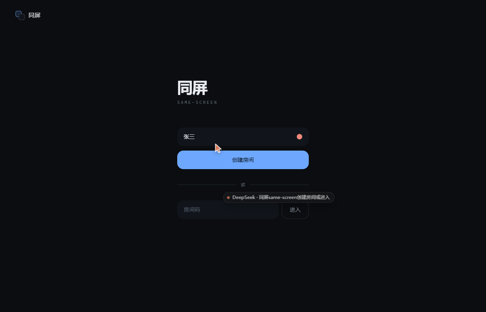
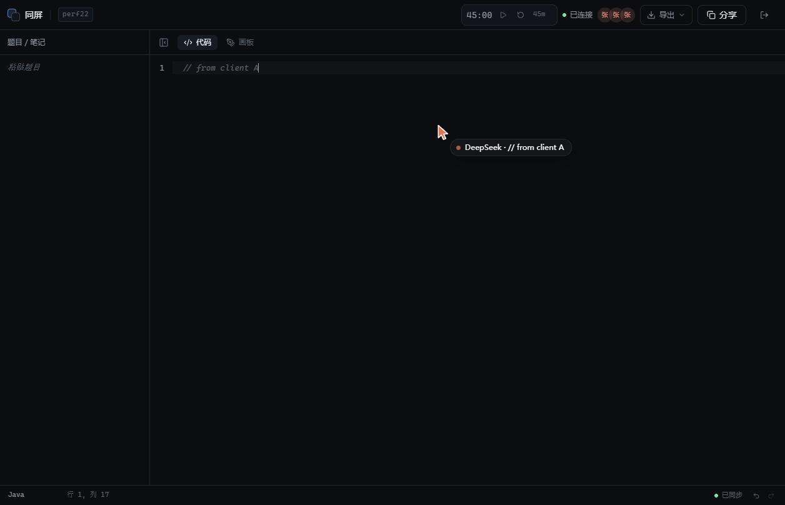
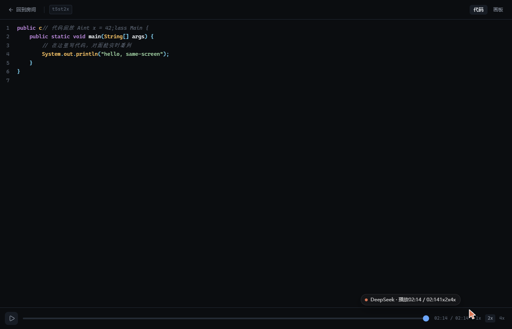
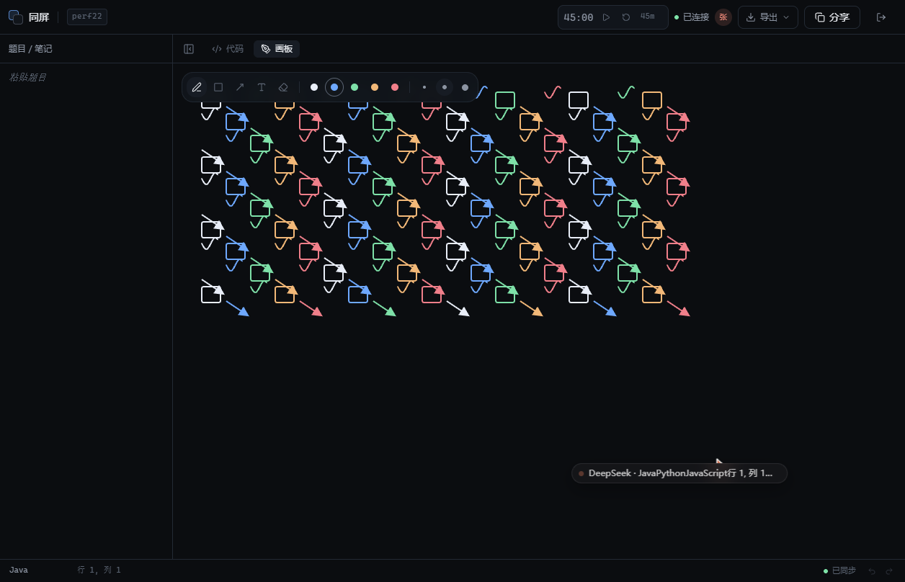
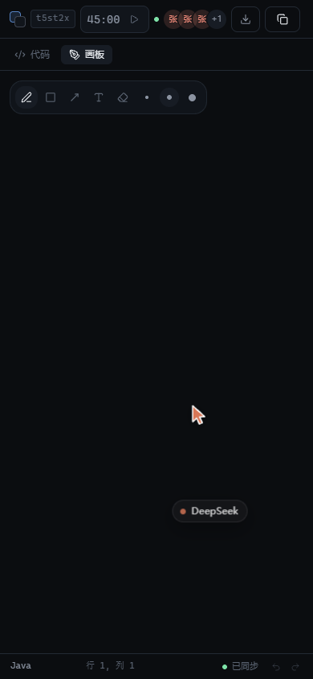

# 同屏 · same-screen

一个链接，两个人远程讲代码：一起改代码、顺手画图、计时，讲完能导出和回放。

作品集项目，7 天 MVP。当前进度：**Day 0–7 全部完成**（详见下方「进度」），可在本地跑通，部署需要你自己的 Cloudflare 账号。



## 现在能做什么

| 能 | 说明 |
| --- | --- |
| 进首页 | 填昵称、换颜色、创建房间跳 `/room/:code` |
| 用房间码加入 | 6 位码校验（去掉了容易看错的 `0/1/i/l/o`） |
| 两人同房写代码 | CodeMirror 6 + `Y.Text`，A 打字 B 立刻看到；Java / Python / JavaScript 切换两端同步 |
| 共享笔记 | 左侧面板也是 CodeMirror，同样走 Yjs |
| 在线成员 | Awareness 里的昵称/颜色，顶栏头像最多 3 个 + `+N` |
| 连接状态 | 顶栏与底部都显示真实状态（连接中 / 已连接 / 已断开），断线自动重连 |
| 撤销重做 | `Y.UndoManager` 只撤自己的操作，底部按钮按栈深度启用 |
| 首次进房有骨架 | 创建房间的人写一次默认模板（`code` 为空且未种过时才写），后来的人不会重复种 |
| 画板 | Konva 自研：笔 / 矩形 / 箭头 / 文字 / 橡皮、5 色 3 线宽，图元走 `Y.Map` 同步 |
| 画板快捷键 | `B` 笔 · `R` 矩形 · `A` 箭头 · `T` 文字 · `E` 橡皮；`Ctrl+Z` / `Ctrl+Shift+Z` 只撤自己的 |
| 画板多人光标 | 对方指针在画板上带昵称和颜色，走 Awareness，不进文档 |
| 计时器 | 45 / 60 分钟，开始 / 暂停 / 重置；只同步 `timerEndsAt`，两端看到同一个剩余时间 |
| 导出 | 顶栏「导出」→ Markdown / 源代码 / 纯文本 / JSON / 画板 PNG；支持系统「另存为」自选路径，浏览器不支持时退化为下载 |
| 分享 | 复制房间链接，`/r/:code` 短链会跳到房间 |
| 回放 | 服务端给每条 Yjs update 记 `{seq, t, update}`，每 30 秒或 50 条更新存一个关键帧；`/room/:code/replay` 按时间轴重放代码和画板，支持播放/暂停与 1x/2x/4x |
| 错码兜底 | 房间码不合法时给提示页，不是白屏 |

**还不能**：两台真实设备（一真机一电脑）交叉验证、真机触屏画板的精修手感、正式 Cloudflare 账号部署（见「部署」）。

## 截图

| 房间（两人在线） | 画板回放 |
| --- | --- |
|  |  |

| 200 图元性能测试 | 手机画板 |
| --- | --- |
|  |  |

## 技术栈

| 层 | 选择 |
| --- | --- |
| 前端 | React 19 · TypeScript（strict）· Vite 8 · Tailwind v4 |
| 路由 | React Router 8 |
| UI 状态 | Zustand（只放当前工具/颜色/Tab，不放共享数据） |
| 代码编辑 | CodeMirror 6 + `y-codemirror.next` |
| 画板 | Konva + react-konva |
| 共享数据 | Yjs（`code` / `notes` / `shapes` / `meta`） |
| 实时服务 | Cloudflare Workers + Durable Object（`partyserver` + `y-partyserver`） |
| 部署 | 单个 Worker 同时供前端静态资源和 WebSocket（同域，免 CORS） |

> PartyKit 托管平台已于 2026-10-23 关停，本项目用的是它的继任者 PartyServer，部署走 `wrangler`。

## 本地启动

```bash
npm install --legacy-peer-deps   # 前端 + worker 一次装完
npm run dev                      # 前端 http://localhost:5173
npm run worker                   # 另开一个终端：实时服务 http://127.0.0.1:8787
```

`npm run dev` 会把 `/parties` 代理到 8787（含 WebSocket），所以前端只认 5173 一个地址。

其它命令：

```bash
npm run typecheck   # 三个 tsconfig 全过才算过（app / vite 配置 / worker）
npm run build       # typecheck + vite build → dist/
npm run smoke       # 房间协议冒烟：双向同步 + 后进拉历史 + 断线重连
npm run deploy      # wrangler deploy（前端和实时服务一起发）
```

`npm run smoke` 要先起 `npm run worker`，默认连 `ws://127.0.0.1:8787/parties/main/smoke01`，可用 `ROOM_WS=` 换地址（例如 `ws://localhost:5173/parties/main/x` 走 Vite 代理）。

### 为什么用 npm 而不是 pnpm

这台机器的 pnpm 12.5.1 在下载大二进制（workerd / rolldown / typescript 原生包）时稳定崩 `thread 'tokio-rt-worker' has overflowed its stack`，分批装也崩。项目本身没有 monorepo 需求，npm 足够。

### 关于 `scripts/exec-shim.cjs`

只给「被沙箱限制了子进程管道的环境」用，比如本机的 AI agent 会话：Vite 在 Windows 上会 `exec("net use")` 探测网络盘，被拦就抛 `spawn EPERM`。手动使用时：

```bash
NODE_OPTIONS="--require ./scripts/exec-shim.cjs" npx vite --port 5173
```

普通开发机不需要它，`npm run dev` 也不引用它。

同一类问题：agent 沙箱里 `wrangler dev` 起不来时会报 `CreateDirectory: #5 拒绝访问; path = miniflare-email-store`，因为 workerd 在会话临时目录建不了子目录。把 `TEMP`/`TMP` 指到工作区内即可（普通终端不需要）：

```bash
mkdir -p .tmp && TEMP="$PWD/.tmp" TMP="$PWD/.tmp" npm run worker
```

## 部署

```bash
npx wrangler login     # 浏览器授权一次
npm run deploy         # 产出 https://same-screen.<你的子域>.workers.dev
```

`wrangler.jsonc` 已经把三件事配好了：Worker 入口、`Main` Durable Object 绑定（`Room` 类）、`dist/` 作为静态资源并开启 SPA 回落。

**已验证**：`wrangler deploy --temporary`（不登录、临时预览账号）发过两次，都成功——2026-11-24 这次 3 个静态资源 321 KiB（gzip 66.5 KiB）、Worker 启动 6 ms，返回 `https://same-screen.<临时子域>.workers.dev`。

**未验证**：正式 `wrangler login` + `npm run deploy`（需要你自己的 Cloudflare 账号）。另外这台机器上 `*.workers.dev` 的 DNS 被解析到了错误 IP（这次是 `157.240.10.32`，上一次 `31.13.85.2`）、TCP 连接超时，**公网可访问性没法在本机确认**；国内环境建议部署后绑自定义域名再验，不要以 workers.dev 直连为准。

## 目录

```text
src/
  app/          router、providers、全局样式
  pages/        Landing、Room、Replay
  features/
    room/       useRoomSession（连接、语言、撤销栈）· RoomHeader / RoomFooter / NotesPanel / StatusDot
    editor/     CodeMirror 扩展、主题、语言、默认骨架、useSeedStarter
    canvas/     Whiteboard（绘制/橡皮/多人光标）、ShapeNode、工具栏、快照
    presence/   usePresence（在线成员）
    timer/      useTimer、TimerControl
    replay/     fetchReplayLog、frameAt（按 seq 重放）、ReplayCode、ReplayCanvas
    export/     四种格式、另存为/降级下载
  lib/          roomCode、identity、env、ydoc（Y.Doc + UndoManager）、provider（YProvider）
  components/   Button 等基础组件
worker/
  index.ts      入口：/parties 交给 PartyServer，其余交给静态资源
  Room.ts       Durable Object：Yjs 副本 + update 日志 + 关键帧 + /replay 接口
docs/
  LOG.md        每天做了什么 / 已验证 / 未验证
  REFERENCE.md  同类项目调研与取舍
  shots/        截图
scripts/
  smoke-room.mjs  房间协议冒烟（双向同步 / 拉历史 / 断线重连）
  room-peek.mjs   裸 WebSocket 读房间真实内容
  add-shape.mjs   塞一个外部图元（验撤销隔离）
  seed-shapes.mjs 批量塞 N 个图元（性能测试）
  exec-shim.cjs   沙箱环境专用补丁
```

## 架构

```text
浏览器 A ─┐                    ┌─ Y.Doc（服务端权威副本）
          ├─ WebSocket ─ Room ─┤   code / notes / shapes / meta
浏览器 B ─┘   (Durable Object) └─ 更新日志（seq, t, update）→ 回放
                    │
                    └─ 静态资源：dist/ 由同一个 Worker 提供
```

- 共享数据只有一份：Yjs 文档。React 不另外存一份，避免双份状态打架。
- 画板同步的是图元（笔迹点集、矩形、箭头、文字），不同步像素。
- 光标和在线状态走 Awareness，不进文档，也不落盘。
- 计时器只存 `timerEndsAt`，不存倒计时。
- 回放复用房间的只读渲染，不写第二套。

## 已知限制

1. 不能运行代码，只是共享编辑器。
2. 不做视频/语音，讲的时候另开腾讯会议。
3. 不做登录，昵称和颜色存在 localStorage，换浏览器就换身份。
4. 房间不设权限，知道链接就能进。
5. 画板没有选择/拖动/缩放，画错了用橡皮（整块删）。
6. 移动端能画但不好画，画板不是为手指精修设计的。
7. 房间数据靠 Durable Object 的 `onSave` 惰性落盘（debounce 2–10 秒）；开发时直接杀进程，最后几秒的改动会丢。正式 Worker 正常关闭时不受影响，但这一点没有做压力验证。
8. 回放记录的是协作期间的 Yjs update，最长保留 4000 条；超出后最旧的被丢弃，老房间的回放起点会落在第一条关键帧上。

## 简历 bullet

> **同屏 same-screen** — 一人一个链接的远程讲代码工具（React 19 + TypeScript + Yjs + Cloudflare Workers）
>
> - 实时协同：用 Yjs CRDT 做代码、笔记、画板图元的多人同步，`Y.Text` + CodeMirror 6 绑定，图元存在 `Y.Map` 里，光标走 Awareness，共享数据只有一份，不额外维护 React state。
> - 服务端：单个 Cloudflare Worker 同时托管静态资源和 Durable Object 房间，`partyserver` + `y-partyserver` 承接 WebSocket 与文档持久化，同域部署免 CORS。
> - 回放：在 Durable Object 里记录每条 update 与 30 秒/50 次关键帧，回放页用空 `Y.Doc` 按序 `applyUpdate` 还原任意时刻的代码与画板，支持 1x/2x/4x。
> - 撤销隔离：`Y.UndoManager` 只跟踪本地 origin，CodeMirror 去掉自带 history，实测能只撤自己的输入。
> - 细节：断线自动重连且不卸载编辑器（`everSynced` 守卫）、计时器只同步结束时间戳、画板 200 图元仍保持 60fps 以上。

## 以后可能做

视频、代码运行、房间列表、模板库、导出 PDF、面试官视角的回放评审。

## 进度

| 天 | 内容 | 状态 |
| --- | --- | --- |
| Day 0 | 脚手架、路由、首页创建/加入、房间壳、房间协议冒烟、试部署 | 完成 |
| Day 1 | 前端打磨、错误/空状态、分享与短链 | 完成（先做了借鉴调研的两条：集中装配 Y.Doc、awareness 节流 50ms） |
| Day 2 | CodeMirror + Y.Text 同步、成员列表、连接状态 | 完成 |
| Day 3 | Konva 画板（笔/矩形/箭头/文字/橡皮）+ 撤销重做 | 完成 |
| Day 4 | 多人光标、计时器、响应式 | 完成（页面拆分为 header/footer/notes/status，移动端顶栏不溢出） |
| Day 5 | 事件日志 + 快照 + 回放页 | 完成（时间轴播放/暂停/1x/2x/4x，代码与画板都能还原） |
| Day 6 | 断线重连、快捷键、移动端、部署 | 完成（修了断线卸载编辑器的 bug；临时部署成功，公网被本机 DNS 干扰无法确证） |
| Day 7 | 双浏览器验收、性能、README、截图 | 完成（两客户端同步 16 字内容一致；200 图元 p50 5.6ms，绘制 p95 22.3ms） |

设计文档：[SPEC.md](./SPEC.md)（做什么）· [ARCHITECTURE.md](./ARCHITECTURE.md)（怎么做）· [AGENTS.md](./AGENTS.md)（硬约束）
